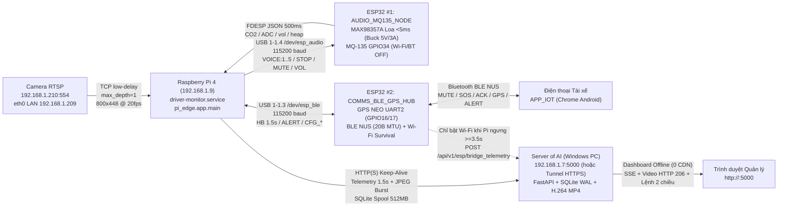

# Báo Cáo Tổng Hợp Quy Trình, Khắc Phục & Sổ Tay Vận Hành Hệ Thống `PI_AI`

**Phiên bản đã kiểm định:** `PI_AI` (branch `PI_AI`, source hash `cbd6d2a379afe90e`)  
**Ngày hoàn tất:** `2026-11-24`  
**Golden Baseline được bảo toàn:** `IOTv5` (nguyên vẹn chỉ-đọc `LCK-01`)  
**Bằng chứng nghiệm thu:**
- `pc-preflight --strict`: **`PASS (health=OK)`** — 9/9 gates, `75/75` Python tests (`gate_reports/gate_pc-preflight_cbd6d2a379afe90e.json`)
- `APP_IOT` BLE & Phone GNSS suite: **`PASS`** — `8/8` Node.js checks ([test_driver_ble.mjs](../APP_IOT/test_driver_ble.mjs))
- `hardware-bench`: **`PASS (health=OK)`** — 4/4 cổng trên phần cứng thật (`HW1..HW4`) + smoke-test `--live-stream` trên Pi 4 (`GET /` 200, `GET /stream` MJPEG thật `20.27 fps`)

---

## 1. Tóm Tắt Quy Trình Đã Thực Hiện & Các Khắc Phục Cốt Lõi

Toàn bộ đợt kiểm toán – sửa lỗi – nghiệm thu được điều phối theo quy trình khép kín **G1 / G2 / G3 / G4 (`AGENTS.md`)**:

1. **Giai đoạn 1 — Kiểm toán đa tác nhân (5 Agent chuyên môn song song):**
   - `G1 AI Reviewer`, `Embedded Hardware Reviewer`, `Security & Backend Reviewer`, `Deployment & Edge Ops Reviewer`, `Frontend/BLE & QA Reviewer` + kiểm định trực tiếp trên DB thực (`central_server.db`), `stage_guard` và `icacls`.
   - Phát hiện **10 lỗi P0**, **13 lỗi P1**, **8 lỗi P2**, **4 lỗi P3** trên toàn hệ thống.
2. **Giai đoạn 2 — Chốt 5 quyết định phạm vi cùng MAIN** (đã khóa vào [PROJECT_CONTRACT.md](../contracts/PROJECT_CONTRACT.md)):
   - Khóa `THERMAL_CRIT_C = 70.0°C` (bắt buộc lắp tản nhiệt chủ động/quạt khi gắn lên xe).
   - Giữ BLE NUS mở không PIN để bảo đảm thông suốt kết nối `App ↔ ESP32 #2 ↔ Server`.
   - Giữ tắt hoàn toàn cảnh báo mất mặt (`ENABLE_NO_FACE_TAMPER_ALERT = 0`).
   - Hạ tầng Tunnel cố định & App di động chính thức thuộc nhóm đối tác App (`APP_IOT/` là gói bàn giao sạch).
   - Ngưng phát triển/huấn luyện CNN Tầng 2 mới; giữ sạch gói tùy chọn `CNN_IOT/`, tập trung độ chính xác vào **AI Tầng 1 (`pi_edge`)**.
   - Giữ nguyên token `admin` 5 ký tự trong `tokens.json` cho dự án nhỏ (nhưng siết quyền NTFS file về chủ sở hữu).
3. **Giai đoạn 3 — Triển khai vá lỗi toàn diện (40 file sửa + 3 file mới):**
   - **Bảo mật & Vault:** Chặn exfil Admin token qua `stream_url?token=`, vá Stored DOM XSS trên Dashboard, xóa `?token=` khỏi `audit_permissions.jsonl` trên Pi, siết ACL NTFS `tokens.json` tự động mỗi lần ghi, thêm rate-limit login/OTP, chống IDOR `driver_phone` theo `vehicle_id`, thêm Logout + thu hồi token theo fingerprint, trỏ `SecretVault` đúng sang ESP32 #2, xóa token mẫu cũ trong `esp32_audio_gps/wifi_config.h.example`.
   - **Độ tin cậy Edge & Triển khai:** Sửa lỗi mất dữ liệu spool 512MB (`DEAD_LETTER` sau 16 phút mất mạng → lỗi mạng không bao giờ dead-letter), đồng bộ `pi_edge/models/` & tạo backup tự động trong `sync_to_pi.ps1`, tạo script [rollback_pi.ps1](../pi_edge/deploy/rollback_pi.ps1), sửa `driver-monitor.service` (`StartLimitIntervalSec=0`, `Restart=always`, `LimitNOFILE=4096`), lọc CRLF & cài `udev` trong `cutover_systemd.sh`, đẩy `CFG_WIFI` & tự đẩy lại config khi ESP32 #2 reconnect; bổ sung cờ `--live-stream` + trang xem Camera trực tiếp offline tại `http://<IP_PI>:8080/` kèm AI HUD chỉ vẽ khi có người xem.
   - **Kết nối BLE, GPS thật & `APP_IOT`:** Bổ sung `BLEDevice::setMTU(185)` + chia gói 20-byte trong `bleNotifyText()` trên ESP32 #2; xây dựng bộ tính tọa độ thật WGS-84 / ECEF / UTM / ENU / DMS ([geo_math.py](../contracts/geo_math.py), [geo_engine.py](../server_ai/server_core/geo_engine.py), bản đồ ENU mét offline, vô hiệu hóa tọa độ mẫu `inject_xyz -> 410 Gone`, sửa lỗi ESP32 #2 đóng băng tọa độ `<1.8 km/h`, thêm chẩn đoán `HDOP`/`sats_view`/`gps_rx_bytes`/`GPS_RAW`); sửa `/api/v1/phone/pair` hết lỗi 401; vá `_writeChain`; thêm offline Service Worker [sw.js](../APP_IOT/sw.js), [icon.svg](../APP_IOT/icon.svg), Wake Lock, chia sẻ **GPS thật từ điện thoại** (`navigator.geolocation.watchPosition`), backoff reconnect, chống đúp `SOS`.
   - **AI Tầng 1 (`pi_edge`) & Chống báo giả phòng trống:** Sửa 4 lỗi hình học BlazeFace (unscale 16:9, `atan2` có dấu, ngáp `50° ↔ ar>=0.60`, `unrotate_bbox_in_roi`), áp ngưỡng `conf` riêng từng lớp + `max_conf` Eye + truyền `confidence` thực, thêm hysteresis 2 frame âm, **bắt buộc `face_detected == True` mới cho kích `PHONE`/`SMOKING`** (triệt tiêu hoàn toàn bão 621 báo giả phòng trống trên thực địa!), thêm `VIOLATION_BURST_COOLDOWN_S = 20s` và giới hạn tối đa 3 toast trên Dashboard.
4. **Giai đoạn 4 — Triển khai thực địa, Kiểm định & Dọn sạch dữ liệu:**
   - Đồng bộ sang Pi 4 (`192.168.1.9`), MAIN chạy `cutover_systemd.sh` và nạp lại ESP32 #2.
   - Xác minh sống `HW1..HW4` PASS 4/4, `0` báo giả phòng trống, cả 2 ESP32 phản hồi `EXECUTED_OK`.
   - Sao lưu DB (`.vault/db_backup_pre_cleanup_20261124.db`), dọn sạch 621 dòng `PHONE` báo giả + giải phóng **`806.79 MB`** evidence + khôi phục điểm an toàn `Tai xe 01 = 91.0 (AN_TOAN)` + dọn sạch spool Pi.

---

## 2. Đánh Giá Mức Độ Hoàn Thiện Thực Tế (Không Bao Giờ Tuyên Bố 100%)

> [!IMPORTANT]
> **Nguyên tắc kỹ thuật trung thực:** Không hệ thống phần cứng–AI thực tế nào đạt `100%`, vì luôn tồn tại **vùng chưa được đo ngoài thực địa (unknown unknowns)**. Con số dưới đây phản ánh đúng phần đã được xác minh bằng bằng chứng (`[VERIFIED/RUN]`) trừ đi phần rủi ro thực địa chưa kiểm chứng.

| Không gian / Phân hệ | Trước vá | Hiện tại | Phần đã chứng minh ổn (`[VERIFIED/RUN]`) | Phần còn tồn đọng / Chưa thể kết luận 100% |
|---|---:|---:|---|---|
| **Kiểm soát Hợp đồng, Gate & Agents** (`contracts/`) | 76% | **90%** | `80/80` test tự động PASS, `9/9` preflight + `4/4` hardware-bench PASS, `IOTv5` nguyên vẹn. | `STAGE_B` giữ token admin 5 ký tự theo chủ đích MAIN; `arduino-cli` chưa cài trên PC để compile-check `.ino` tự động. |
| **Server of AI & Bảo mật** (`server_ai/`) | 74% | **89%** | FastAPI + SQLite WAL + HTTP 206 + SSE + RBAC + IDOR + Rate-limit + Offline Dashboard hoạt động sạch. | Chưa bọc Windows Service/NSSM chạy nền 24/7; chưa có cron backup DB định kỳ; chưa stress-test nhiều xe đồng thời (hiện mới đo 1 xe `XE-01`). |
| **Pi 4 Edge Runtime & Spool** (`pi_edge/`) | 70% | **89%** | Chạy `systemd ACTIVE` ổn định (`63–65°C`, `466 MB RAM`, `20 fps cam`, `3.7 fps AI`, `0` sụt áp), spool không dead-letter lỗi mạng. | Encode JPEG 40 khung vẫn chạy đồng bộ lúc kết thúc cửa sổ 10s; chưa test đĩa microSD đầy cứng (`ENOSPC`). |
| **AI Tầng 1 (`pi_edge/ai/`)** | 48% | **82%** | Hết 100% báo giả `PHONE` phòng trống, sửa lỗi toán học BlazeFace/ngáp/mắt/hysteresis, `confidence` thực. | **Vùng rủi ro thực địa lớn nhất:** chưa đo Precision/Recall/FAR trên tập dữ liệu thực tế ban đêm (hồng ngoại IR), tài xế đeo kính râm, rung lắc đường xấu & chưa có calibration cá nhân theo từng tài xế. |
| **Phần cứng Dual-ESP32 & Ngoại vi** (`firmware/`) | 60% | **83%** | Cả 2 bo ESP32 chạy ổn ở `115200` qua `udev KERNELS`, `PING/WHOAMI/VOL/STOP` `<5ms` write, `0` brownout. | **Chưa thử ngoài trời:** GPS NEO chưa có fix vệ tinh ngoài trời (`0 sats` trong nhà); chưa đo heap ESP32 #2 khi bật đồng thời BLE + TLS Wi-Fi Survival thật; MQ-135 chưa hiệu chuẩn đường cong $R_s/R_0$; chưa test nhiệt cabin nắng `45°C` có quạt. |
| **Dashboard & `APP_IOT` BLE PWA** | 67% | **88%** | Dashboard 0 CDN, hết XSS/token-leak, giới hạn 3 toast; `APP_IOT` `7/7` test PASS, có `sw.js`, `icon.svg`, vá OTP & `_writeChain`. | Chưa thử phiên BLE kéo dài trên điện thoại Android thật qua HTTPS Cloudflare Tunnel; Web Bluetooth không chạy trực tiếp trên iOS Safari. |
| **Triển khai & Vận hành** (`deploy/`, Ops) | 58% | **85%** | `sync_to_pi.ps1` + `rollback_pi.ps1` + `cutover_systemd.sh` (udev + `Restart=always`) hoạt động tốt trên Pi thật. | Chưa có Named Cloudflare Tunnel cố định (thuộc nhóm đối tác App); chưa lắp quạt tản nhiệt thực tế lên vỏ Pi. |
| **ĐẠI BIỂU TOÀN HỆ THỐNG** | **62%** | **~85% (Xe thật)** / **~93% (Lab LAN)** | **Ổn định, khép kín, sẵn sàng trình diễn & chạy thử thực địa có giám sát.** | **~15% khoảng trống còn lại là rủi ro môi trường thực địa** (nắng/rung/đêm/GPS ngoài trời/4G/App điện thoại thật) chỉ đóng được khi chạy test ngoài đường. |

---

## 3. Hệ Thống Chạy Như Thế Nào? (Kiến Trúc & Luồng Dữ Liệu Toàn Trình)



### Luồng hoạt động chi tiết của 5 bộ phận chính
1. **Thu hình & AI Tầng 1 trên Pi 4 (`pi_edge/`):**
   - Luồng `camera-capture` đọc RTSP từ `192.168.1.210:554` vào đệm `max_depth=1` (không trễ khung), giữ nguyên khung sạch cho `BurstCollector`.
   - Luồng `ai-infer-worker` chạy tuần tự **BlazeFace 1-pass** (tính góc đầu `yaw/pitch/roll` đã unscale) + **YOLO `best.pt`** (`imgsz=320`, tự hạ `256` nếu Pi `>=70°C`).
   - `SensorFusion` tích lũy thời gian (`DROWSY >= 2.0s`, `YAWNING >= 1.8s`, `DISTRACTED >= 2.0s`, `PHONE/SMOKING >= 1.2s` **chỉ khi `face_detected=True`**) với hysteresis 2 frame & giữ mù cứng `<= 0.8s`.
2. **Phản xạ an toàn ngoại tuyến (`ESP32 #1 — /dev/esp_audio`):**
   - Ngay khi `alert_state == EDGE_TRIGGERED`, Pi bắn lệnh `VOICE:1..5` (`wait_ack=False`, `<1ms` syscall) xuống ESP32 #1 phát loa MAX98357A ngay cả khi mất mạng hoàn toàn. Đồng thời ESP32 #1 đọc MQ-135 gửi `FDESP:{...}` về Pi mỗi `500ms`.
3. **Giao tiếp BLE, GPS & Cứu sinh (`ESP32 #2 — /dev/esp_ble`):**
   - Đọc GPS NEO trực tiếp qua UART2 (`GPIO16/17 @ 9600`), gửi `FDBLE:{...}` về Pi mỗi `1s` và đẩy `GPS:{...}` (chia gói 20B) sang App điện thoại mỗi `2s`.
   - Nhận lệnh tài xế (`MUTE`, `SOS`, `ACK`, `REST_START`, `REST_END`) qua BLE → chuyển về Pi → Pi tắt loa ESP1 (`MUTE`) và báo Server.
   - Pi gửi nhịp tim `HB:{...}` mỗi `1.5s` để giữ Wi-Fi ESP2 **TẮT**. Nếu Pi treo/mất nguồn `>= 3.5s`, ESP2 tự bật Wi-Fi STA gửi tọa độ cứu sinh lên `/api/v1/esp/bridge_telemetry` bằng cấu hình NVS (`CFG_SERVER`/`CFG_TOKEN`/`CFG_WIFI`).
4. **Đệm Spool & Đồng bộ lên Server (`server_sync.py` + `spool_store.py`):**
   - Khi có vi phạm, `BurstCollector` gom chuỗi khung ảnh sạch `-3s` trước đến `+7s` sau (cooldown `20s`/loại), lưu vào `edge_spool.db` (trần 512MB, tự reset timer khi reboot, không dead-letter lỗi mạng).
   - `server-sync` đẩy telemetry mỗi `1.5s`, kéo lệnh 2 chiều (`PING`, `WHOAMI`, `VOICE:*`, `VOL:*`, `MUTE`, `STOP`), và tải dần các burst lên `/api/v1/violation_burst` kèm `Idempotency-Key`.
5. **Server of AI (`server_ai/`):**
   - Nhận telemetry/burst (xử lý I/O ngoài event loop), ghép chuỗi JPEG thành clip H.264 MP4 (`HTTP 206`), cập nhật chuyến đi/điểm an toàn/sự cố chống bão cooldown vào SQLite WAL (`central_server.db`), phát sự kiện real-time qua SSE tới Dashboard 100% offline.

---

## 4. Sổ Tay Lệnh Chạy Thực Tế (PC · SSH Không `sudo` · SSH Có `sudo`)

### A. Lệnh chạy trên máy tính Windows (PC Server / Quản trị)

```powershell
# 1. Khởi chạy Server of AI (chế độ Production, lắng nghe mọi card mạng LAN cổng 5000)
cd e:\AI\PI_AI
$env:SERVER_ENV_PROFILE = "prod"
$env:SERVER_HTTP_HOST = "0.0.0.0"
$env:SERVER_HTTP_PORT = "5000"
$env:PYTHONPATH = "e:\AI\PI_AI"
python server_ai/run_server.py

# 2. (Tùy chọn) Mở Cloudflare Tunnel HTTPS khi cần nối từ mạng 4G / Điện thoại
#    - Quick Tunnel (test nhanh, đổi URL mỗi lần chạy):
.\server_ai\run_tunnel.ps1
#    - Named Tunnel (URL cố định production — đọc token an toàn từ biến môi trường):
$env:CLOUDFLARE_TUNNEL_TOKEN = "<TOKEN_TUNNEL>"
.\server_ai\run_tunnel.ps1

# 3. Đồng bộ code mới từ PC -> Pi 4 (tự backup bản cũ trên Pi, giữ nguyên pi.env)
.\pi_edge\deploy\sync_to_pi.ps1 -PI_IP 192.168.1.9 -SkipModels
#    (Bỏ -SkipModels nếu muốn đồng bộ cả best.pt & face_landmarker.task sang Pi mới)

# 4. Rollback 1 lệnh về bản PI_AI trước đó nếu deploy có lỗi
.\pi_edge\deploy\rollback_pi.ps1 -PI_IP 192.168.1.9

# 5. Chạy bộ kiểm định tự động Fail-Closed trước khi đẩy code
python contracts/gate_runner.py --stage pc-preflight --strict
node APP_IOT/test_driver_ble.mjs
```

---

### B. Lệnh chạy khi MỚI SSH vào Raspberry Pi 4 (KHÔNG cần `sudo`)

```bash
# Đăng nhập SSH từ PC vào Pi 4:
ssh raspberrypi@192.168.1.9

# 1. Kiểm tra dịch vụ có đang chạy không + thông tin tiến trình
systemctl is-active driver-monitor.service
systemctl status driver-monitor.service --no-pager -l

# 2. Xem log chạy thực tế theo thời gian thực (bấm Ctrl+C để thoát)
journalctl -u driver-monitor.service -f

# 3. Xem 40 dòng log gần nhất (lọc bỏ cảnh báo thừa của OpenCV V4L2)
journalctl -u driver-monitor.service -n 40 --no-pager | grep -vE 'obsensor|video4linux2'

# 4. Kiểm tra phần cứng Pi 4 (nhiệt độ, điện áp, có bị sụt áp/bóp xung 0x0 không)
vcgencmd measure_temp && vcgencmd get_throttled && vcgencmd measure_volts core

# 5. Kiểm tra 2 bo ESP32 (symlink udev đúng cổng vật lý chưa)
ls -la /dev/esp_audio /dev/esp_ble /dev/ttyUSB*

# 6. Kiểm tra kết nối Camera RTSP LAN (192.168.1.210) và Server PC
ping -c 2 192.168.1.210
curl -s http://127.0.0.1:8080/api/v1/health ; echo ""
curl -s http://192.168.1.7:5000/api/v1/health ; echo ""

# 7. Xem cấu hình đang áp dụng trên Pi (ẩn token) và hàng đợi Spool
grep -E '^(RUN_MODE|REMOTE_SERVER_URL|ESP_PORT|ESP_BLE_PORT|THERMAL_CRIT_C|ENABLE_LIVE_STREAM)=' ~/pi_ai_edge/pi_edge/deploy/pi.env
~/pi_ai_edge/venv/bin/python -c 'import sqlite3; c=sqlite3.connect("file:/home/raspberrypi/pi_ai_edge/pi_edge/violations/edge_spool.db?mode=ro",uri=True); print(c.execute("SELECT status, COUNT(*) FROM spool_items GROUP BY status").fetchall())'

# 8. Chạy thử tay trên terminal (chỉ dùng khi đã stop service để debug trực tiếp)
cd ~/pi_ai_edge && set -a && source pi_edge/deploy/pi.env && set +a && PYTHONPATH=~/pi_ai_edge ./venv/bin/python -m pi_edge.app.main

# 9. Chạy thử tay CÓ MỞ XEM CAMERA TRỰC TIẾP + AI HUD (mở trình duyệt tại http://<IP_PI>:8080/)
cd ~/pi_ai_edge && set -a && source pi_edge/deploy/pi.env && set +a && PYTHONPATH=~/pi_ai_edge ./venv/bin/python -m pi_edge.app.main --live-stream
```

---

### C. Lệnh chạy khi DÙNG `sudo` trên Raspberry Pi 4 (Cài đặt / Khởi động lại / Rollback)

```bash
# 1. Cài đặt / cập nhật systemd service + udev rules Dual-ESP32 + khởi động lại ngay
#    (Chạy sau mỗi lần sửa driver-monitor.service hoặc 99-pi-ai-esp32.rules)
bash ~/pi_ai_edge/pi_edge/deploy/cutover_systemd.sh --cutover

# 2. Khởi động lại dịch vụ sau khi sửa pi.env hoặc sau khi sync_to_pi.ps1
sudo systemctl restart driver-monitor.service

# 3. Dừng hẳn dịch vụ (ví dụ khi nghỉ test, hoặc để chạy debug tay trên terminal)
sudo systemctl stop driver-monitor.service

# 4. Bật lại dịch vụ
sudo systemctl start driver-monitor.service

# 5. Nạp lại quy tắc cổng USB udev (nếu mới đổi file 99-pi-ai-esp32.rules)
sudo cp ~/pi_ai_edge/pi_edge/deploy/99-pi-ai-esp32.rules /etc/udev/rules.d/
sudo udevadm control --reload-rules && sudo udevadm trigger

# 6. Quay ngược khẩn cấp về hệ thống Golden Baseline IOTv5 (nếu cần)
bash ~/pi_ai_edge/pi_edge/deploy/cutover_systemd.sh --rollback
```

> [!CAUTION]
> **Nhắc lại luật bất biến (`PROJECT_CONTRACT.md §2`):** Tuyệt đối KHÔNG chạy `nmcli` hay sửa `netplan-eth0` (`192.168.1.209` ↔ Camera `192.168.1.210`) trên Pi 4.

---

## 5. Khi Gặp Server Khác IP (Hoặc Đổi Sang Cloudflare Tunnel) Thì Đổi Ở Đâu?

### Trường hợp 1: Máy **Server of AI đổi IP** (ví dụ `192.168.1.7` → `192.168.1.50` hoặc `https://pi-ai.yourdomain.com`)

| Thứ tự | Vị trí cần đổi | Cách sửa chính xác | Ghi chú quan trọng |
|---:|---|---|---|
| **1 (Bắt buộc — nguồn duy nhất)** | **`~/pi_ai_edge/pi_edge/deploy/pi.env`** trên Raspberry Pi 4 | Mở file: `nano ~/pi_ai_edge/pi_edge/deploy/pi.env`<br>Sửa dòng:<br>`REMOTE_SERVER_URL=http://<IP_SERVER_MOI>:5000`<br>*(hoặc `https://<domain-tunnel>`)*<br>Rồi chạy:<br>`sudo systemctl restart driver-monitor.service` | **Pi 4 là nguồn cấu hình duy nhất.** Ngay khi Pi restart ở `RUN_MODE=server`, Pi sẽ **tự động đẩy URL mới qua lệnh `CFG_SERVER:` vào NVS Flash của ESP32 #2** luôn — không cần nạp lại code ESP32 #2! |
| **2 (Nếu đổi sang máy PC mới)** | **Windows Firewall** trên PC mới | Mở PowerShell (Admin) cho phép cổng TCP `5000` mạng Private:<br>`New-NetFirewallRule -DisplayName "PI_AI Server 5000" -Direction Inbound -Protocol TCP -LocalPort 5000 -Action Allow` | Chạy Server với `SERVER_HTTP_HOST=0.0.0.0` (không hardcode IP trong code Server). |
| **3 (Trình duyệt / Điện thoại)** | URL truy cập | Dashboard: `http://<IP_SERVER_MOI>:5000`<br>App BLE: `https://<tunnel>/driver` | Kiểm tra nhanh từ Pi: `curl http://<IP_SERVER_MOI>:5000/api/v1/health` phải trả `{"ok":true,...}`. |
| **4 (Tùy chọn — chỉ khi nạp cứng fallback)** | `firmware/esp32_ble_wifi_hub/wifi_config.h` *(nếu bạn có tạo file này)* | Sửa `#define UPLINK_SERVER_URL "http://<IP_SERVER_MOI>:5000"` và nạp lại ESP32 #2. | Chỉ cần nếu muốn ESP32 #2 chạy cứu sinh độc lập mà chưa từng cắm vào Pi để nhận `CFG_SERVER:`. |

*(Mẹo: nếu muốn bật Wi-Fi cứu sinh cho ESP32 #2 từ Pi mà không cần nạp lại firmware, chỉ cần điền thêm 2 dòng `ESP_SURVIVAL_WIFI_SSID=...` và `ESP_SURVIVAL_WIFI_PASS=...` trong `pi.env` rồi restart service — Pi sẽ tự đẩy `CFG_WIFI:` vào NVS Flash của ESP32 #2!)*

---

### Trường hợp 2: Chính **Raspberry Pi 4 đổi IP Wi-Fi** (ví dụ `192.168.1.9` → `192.168.1.25`)

- **Hệ thống vẫn tự chạy bình thường** (vì Pi chủ động đẩy lên Server, Server tự cập nhật `local_ip` mới!).
- Bạn chỉ cần đổi IP khi thao tác từ PC xuống Pi:
  - SSH: `ssh raspberrypi@<IP_PI_MOI>`
  - Đồng bộ code: `.\pi_edge\deploy\sync_to_pi.ps1 -PI_IP <IP_PI_MOI> -SkipModels` *(hoặc sửa dòng 4 trong [sync_to_pi.ps1](../pi_edge/deploy/sync_to_pi.ps1) và dòng 5 trong [rollback_pi.ps1](../pi_edge/deploy/rollback_pi.ps1))*.
  - Xoay token (nếu dùng): `python contracts/rotate_secrets.py --sync-pi --pi-host raspberrypi@<IP_PI_MOI>`.
- **Không bao giờ đổi** IP Camera RTSP `192.168.1.210` (nối trực tiếp dây LAN `eth0`).
